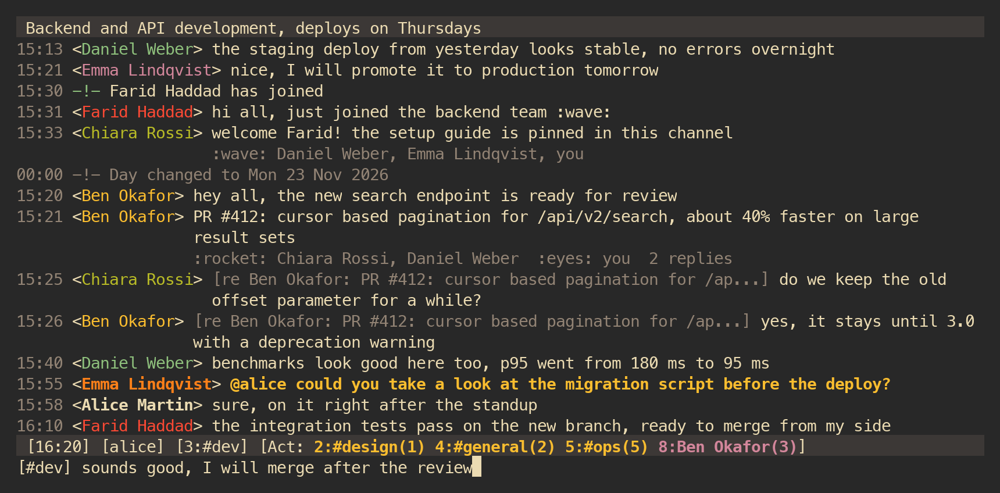

# asciirc

A terminal Rocket.Chat client in the style of irssi. It takes around **6MB of memory** and runs easily
on devices like a Pi Zero `:)`



## Install

On macOS with Homebrew:

```
brew install tamasgal/tap/asciirc
```

## Build

To build from source you need a C99 compiler and OpenSSL.

```
make
```

## Configure

The config file is `~/.config/asciirc/config`. Run `chmod 600` on it, otherwise it will complain `;)`

Log in with a personal access token (My Account, Personal Access Tokens in Rocket.Chat) or with a
username, in which case asciirc asks for the password at startup.

One server:

```
server = https://chat.example.com
user_id = YOUR_USER_ID
token = YOUR_TOKEN

theme = solarized-dark
nicks = name
```

Several servers, each in its own `[name]` section, with the shared settings at the top:

```
theme = solarized-dark
nicks = name

[work]
server = https://chat.example.com
user_id = YOUR_USER_ID
token = YOUR_TOKEN

[home]
server = https://chat.example.org
username = YOUR_USERNAME

[lab]
server = https://chat.lab.example
user_id = YOUR_USER_ID
token = YOUR_TOKEN
insecure = 1
```

Options:

- `server`, `user_id`, `token`, `username`: where and how to log in
- `insecure = 1`: do not verify the TLS certificate of that server
- `theme`: `default`, `solarized-dark`, `solarized-light`, `monokai`, `gruvbox`, `gruvbox-light`, `nord`, `dracula`, `tokyo-night`, `catppuccin-mocha`, `catppuccin-latte`, `one-dark`, `everforest`, `rose-pine`, `kanagawa`, `ayu-dark`, `ayu-light`, `github-dark`, `github-light`, `nightfox`, `palenight`, `zenburn`, `papercolor-light`, `synthwave`, `matrix`, `amber`, `mono`, or `random` for a different one at every start
- `nicks = name` shows real names, `nicks = username` shows usernames

`./asciirc -S work` connects to the `[work]` server only.

## Run

```
./asciirc
```

Type `/help` inside the client for commands. `./asciirc -h` lists the command line options.

`make install` copies the binary to `/usr/local/bin`, `make PREFIX=~/.local install` to somewhere else.

## Usage

Windows:

- `Ctrl+G` go to a window: type a number or part of a name (`work/gen` for a server), `Tab` cycles matches, `Enter` switches
- `Ctrl+X` jump to the next window with unread messages
- `Ctrl+N` / `Ctrl+P` next / previous window
- `PgUp` / `PgDn` scroll
- `Ctrl+S` scroll mode: `j` / `k` line, `Ctrl+U` / `Ctrl+D` half page, `Ctrl+B` / `Ctrl+F` page, `g` / `G` top / bottom, `/` searches older lines as you type (`Enter` keeps the match, `Esc` cancels), `n` / `N` next older / newer match, `q` or `Esc` leaves and jumps back to the bottom

Messages:

- `Ctrl+R` select a message, `Up` / `Down` move the selection
- `r` or `Enter` reply in its thread, `Esc` cancels the reply
- `+` react: type an emoji name, `Tab` cycles matches, `Enter` sends, the same emoji again removes it
- `Tab` completes @mentions

Commands: `/join #channel`, `/query user`, `/part`, `/win list`, `/server`, `/theme name|random`, `/quit`.

## License

MIT, see `LICENSE`.
